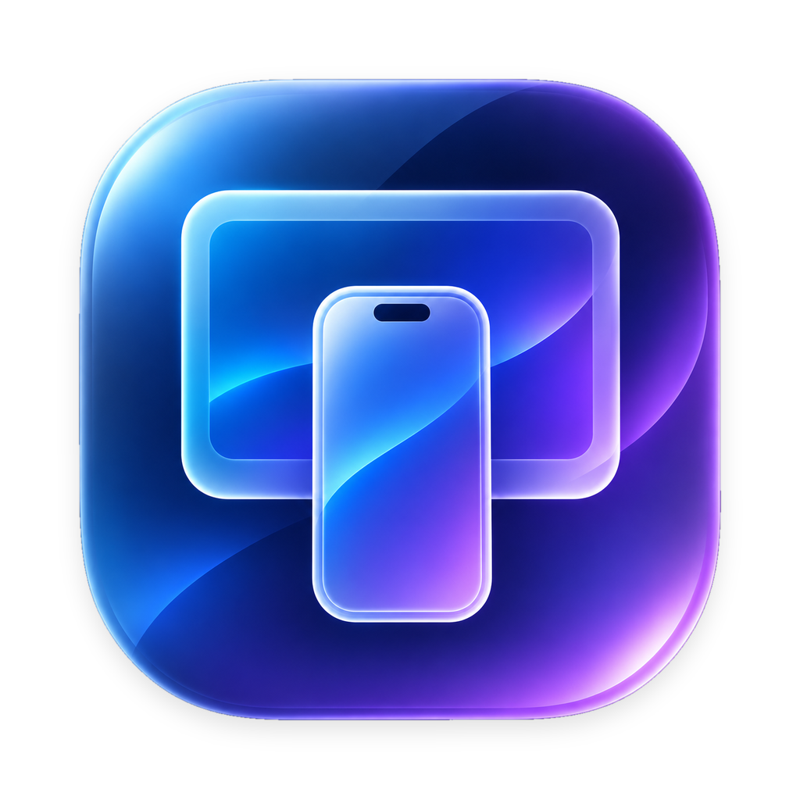

# PMD3Bar



A macOS menu bar app to view and control one or more iPhones from your Mac, over cable or Wi-Fi.
It uses [pymobiledevice3](https://github.com/doronz88/pymobiledevice3), bundled in the app with its own
Python: no `sudo`, no `tunneld`, no terminal needed.

To install, update and troubleshoot, see the **[RUNBOOK](RUNBOOK.md)**.

## What it does

**From the menu bar**
- Lists iPhones connected over USB or Wi-Fi, with iOS version and connection state.
- Shows whether the Developer Disk Image (DDI) is mounted, and mounts it **automatically** when you
  connect an iPhone.
- Starts mirroring each iPhone in its own window. Several iPhones can be mirrored at once.
  iPhones running iOS earlier than 27 open a window with Tools only.
- **Notifications** when an iPhone connects or disconnects, the DDI is mounted, an install finishes
  or mirroring stops.
- **Global shortcut ⌥⌘M** to show or hide the selected iPhone's window.
- **Launch at login**, toggled from the menu (Settings).
- **Restart or shut down** an iPhone: right-click it in the menu.
- **Grid**: all mirrored iPhones side by side in a single window.
- **Update notice**: flags in the menu (and with a notification) when a new pymobiledevice3
  version is released, with the command to update.

**In each window**
- Live iPhone screen, with audio, touch, keyboard, hardware buttons and shared clipboard.
  This is the pymobiledevice3 web viewer, shown in a native window.
- By default you see **only the iPhone**, like the Simulator: the window is transparent around the
  bezel and takes the device's shape, and dragging the bezel moves it. The viewer controls (zoom, rotation, bezel, buttons,
  clipboard, accessibility) and Tools open only when you ask, from the buttons in the window toolbar.
- Screen recording **with the iPhone's audio** and screenshots, saved to `~/Downloads`.
- **Tools** panel (icon on the right of the window toolbar):
  - **Apps**: installed apps with icons, `.ipa` install, launch, uninstall.
    **Launch with options** passes arguments and environment variables (remembered per app).
    Right-click an app to browse its files or **download its container** to `~/Downloads`.
    Before installing, the `.ipa` is checked against the iPhone (signature, provisioning profile,
    UDID, bundle ID, certificate, entitlements). If the iPhone would refuse it, the window says why
    and offers to **resign** it with a profile and certificate on this Mac (saved to `~/Downloads`).
    When none fits, it lists what to create on the developer portal for that app: certificate,
    device, App Groups, App ID with its capabilities, extensions, profile.
  - **Files**: the iPhone's Media folder (photos in `DCIM`) or an **app's container**, with download,
    upload and delete. The whole container (Documents, Library, tmp) opens for development-signed
    apps; for the others only the Documents folder, when the app shares its files.
  - **Location**: simulated GPS location, picked on a map. The map starts from the Mac's location
    or from the last location simulated on that iPhone. Closing the window restores the real one.
  - **Developer**:
    - **Conditions**: slow network (3G, Edge, packet loss…), thermal state, GPU performance.
    - **Processes**: CPU and memory of each process, with the option to kill it.
    - **Crashes**: crash and diagnostic reports, to read, download or delete.
    - **Log**: live system log, with filters and export.
  - **Info**: model, iOS build, serial number, UDID and the other identifiers (right-click to copy),
    storage used and free, battery charge, maximum capacity, cycles and temperature. Restart and
    shut down.
- Drop an `.ipa` on the window to install it, or other files to copy them to the iPhone.

## Requirements

- Apple Silicon Mac with macOS 14 or later.
- Swift 6: the Command Line Tools are enough (`xcode-select --install`), Xcode is not needed.
- iPhone with iOS 17 or later, paired with the Mac over cable at least once.
  Mirroring needs iOS 27 or later; Apps, Files, Location and Log work on earlier versions too.
- Developer Mode enabled on the iPhone (Settings ▸ Privacy & Security ▸ Developer Mode).

## Quick start

```bash
cd path/to/PMD3Bar   # the cloned repository
make python    # once: prepares the Python bundled in the app (about 260 MB)
make install   # builds the app and copies it to ~/Applications
open ~/Applications/PMD3Bar.app
```

Then, from the iPhone icon in the menu bar: **Mount** the DDI if needed, and press ▶ next to the iPhone.

## How it's built

```
PMD3Bar.app/Contents/
├── MacOS/PMD3Bar                SwiftUI interface (menu bar + windows)
└── Resources/
    ├── python/                  standalone CPython 3.12 + pymobiledevice3 (pinned version)
    └── pmd3bar_helper.py        Python functions the command line doesn't offer
```

```
┌────────────── PMD3Bar (Swift) ──────────────┐
│ Menu bar         Windows (WKWebView)         │
│      │                 │ http://127.0.0.1:8080, 8081…
└──────┼─────────────────┼─────────────────────┘
       │ child processes │
       ▼                 ▼
  python -m pymobiledevice3 …         ← one process per command,
  python pmd3bar_helper.py …            one serve-web per iPhone
       │
       ▼  usbmuxd (USB / Wi-Fi) + rootless iOS 17+ tunnel
    iPhone
```

- **The app doesn't import Python**: it runs `python -m pymobiledevice3 …` as a child process and
  reads the JSON output. The target iPhone is set by the `PYMOBILEDEVICE3_UDID` variable.
- **Mirroring**: each iPhone gets a `developer core-device display serve-web` process on its own
  port (from 8080 up). Each process has its own tunnel, so several iPhones can run in parallel.
- **`pmd3bar_helper.py`** does what the pymobiledevice3 command line can't:
  - lists iPhones even when a Wi-Fi connection doesn't answer (`usbmux list` fails entirely
    in that case);
  - lists folders with file type and size, in the Media folder or an app's container (falling back
    to its Documents folder when the whole container is refused);
  - reads device identity, storage and battery for the Info tab, keeping only the fields shown;
  - lists apps with name, bundle ID and version only, without the full metadata, which can
    contain app keys;
  - fetches app icons over a single connection and caches them in `~/Library/Caches/PMD3Bar/icons`.
- **Which Python**, in order of priority:
  1. the one bundled in the app;
  2. the `PMD3_PYTHON` environment variable;
  3. `~/miniforge3/envs/pymobiledevice/bin/python` (handy with `make dev`).

### Sources

```
Sources/PMD3BarCore/        pure logic, no UI: tested by `make test`
  Models.swift              Device and parsing of the iPhone list, DDI and mirroring states
  RunResult.swift           command result and readable error message
  Versions.swift            version comparison (update notice)
  ViewerLayout.swift        viewer geometry and width of the "iPhone only" window
  Signing.swift             .ipa checks, provisioning profiles, resign plans, portal requirements
  DeviceInfo.swift          Info tab parsing, launch options, Files tab scope (Media or app container)
  DeviceDates.swift         dates written by the helper (crash reports)
Sources/PMD3Bar/
  App/                      startup, menu bar menu, state, settings, notifications, menu bar icon
  Device/                   running pymobiledevice3, mirroring sessions, iPhone tools, .ipa resigning
  Viewer/WebView.swift      viewer WKWebView: layout, recording with audio, downloads
  Windows/                  per-iPhone window, grid, window sizing
  Tools/                    Tools panel, one tab per file
Tests/PMD3BarCoreTests/     tests for the pure logic (`make test`)
Resources/                  Info.plist, entitlements, pmd3bar_helper.py, icons
scripts/                    fetch-python.sh, build-app.sh, release.sh, check.py, make-icon.py
```

| File | Contents |
|---|---|
| `Resources/pmd3bar_helper.py` | Extra Python functions (robust device list, files, apps, icons, crashes) |
| `scripts/fetch-python.sh` | Downloads CPython (sha256 verified), installs pymobiledevice3 into `build/python.new` and puts it in use only if it passes `check.py` |
| `scripts/build-app.sh` | Builds, creates `build/PMD3Bar.app`, build number, ad-hoc signature (Developer ID with `SIGN_IDENTITY`) |
| `scripts/release.sh` | Developer ID signature with hardened runtime, notarization, stapling, zip (`make release`) |
| `scripts/check.py` | Checks that pymobiledevice3 offers everything the app uses (`make check`) |
| `scripts/make-icon.py` | Cuts out the artwork and generates every icon size (`make icon`) |
| `Makefile` | `dev`, `python`, `python-rollback`, `app`, `release`, `run`, `install`, `test`, `check`, `check-static`, `icon`, `clean` |

## Known limitations

- Mirroring only on iOS 27 or later. Recordings include audio only if the viewer is playing it
  (audio on).
- Over Wi-Fi the iPhone must be unlocked or awake and on the same network. The first pairing needs the cable.
- Simulated location and launching apps need the DDI mounted.
- The iPhone's **real** location can't be read from the Mac: the developer services only allow
  setting or clearing the simulated one, and coordinates are redacted in `locationd` logs. That's
  why the map uses the Mac's location, which is close to the connected iPhone.
- `make app` / `make install` sign ad-hoc: fine on this Mac. To give the app to others use
  `make release` (Developer ID + notarization, see the [RUNBOOK](RUNBOOK.md#11-releasing-to-other-macs)).
  The app doesn't update itself: the repository is private, so there is no public release feed.
- Resigning an `.ipa` signs the app only: extensions need their own profiles and are left out with
  an explicit (non-wildcard) profile, and capabilities the profile doesn't grant are dropped.
- The app depends on pymobiledevice3 commands and internal functions: update it following the
  [RUNBOOK](RUNBOOK.md#4-updating-pymobiledevice3).

## License

pymobiledevice3 is licensed under GPL-3.0-or-later. The app bundles it, so if you distribute it
to others you must do so under the GPL and make the source code available.
